# Đặc tả Kiến trúc Cơ sở Dữ liệu Toàn Hệ Sinh Thái (Occupify Ecosystem ERD)

> **Phạm vi tài liệu**: Áp dụng chung cho toàn bộ hệ thống Microservices Occupify.  
> **Mục đích**: File tài liệu chuẩn hóa dùng chung (Shared Ecosystem Documentation). Khi khởi tạo hoặc phát triển bất kỳ microservice nào trong hệ thống (`occupify-identity`, `occupify-core`, `occupify-payment`, `occupify-notification`, `occupify-admin`), chỉ cần sao chép file này sang thư mục `docs/` của service đó để nắm toàn cảnh dữ liệu và liên kết liên dịch vụ.

---

## 1. Tổng quan 5 Bounded Contexts trong Hệ Sinh Thái Occupify

Hệ thống Occupify được thiết kế theo mô hình **Microservices Architecture**, phân tách theo **5 Bounded Contexts** (theo chuẩn Domain-Driven Design - DDD):

```
+-----------------------------------------------------------------------------------------------------------------------+
|                                                  OCCUPIFY ECOSYSTEM                                                   |
+-------------------+-------------------+------------------------------+-----------------------+------------------------+
|  1. Identity      |  2. Core          |  3. Payment                  |  4. Notification      |  5. Administration     |
+-------------------+-------------------+------------------------------+-----------------------+------------------------+
|  occupify-identity|  occupify-core    |  occupify-payment            |  occupify-notification|  occupify-admin        |
|  Port: 8181       |  Port: 8182       |  Port: 8183                  |  Port: 8184           |  Port: 8185            |
|  DB: occupify_id  |  DB: occupify_core|  DB: occupify_payment        |  DB: occupify_notif   |  DB: occupify_admin    |
|                   |                   |                              |                       |                        |
|  - Users & Auth   |  - Projects & Jobs|  - Wallets (Available/Locked)|  - In-App Alerts      |  - Platform Moderation |
|  - User Profiles  |  - Bids & Offers  |  - Transactions (Ledger)     |  - Event Notices      |  - Reports & Evidences |
|  - Experiences    |  - Reviews        |  - Contracts & Terms         |  - Push Notifications |  - Flagged Accounts    |
|  - Educations     |  - Skills Catalog |  - Cancellations & Disputes  |                       |  - System Audit Logs   |
|  - Qualifications |                   |  - Escrow Fund Holding       |                       |                        |
+-------------------+-------------------+------------------------------+-----------------------+------------------------+
```

---

## 2. Nguyên tắc Thiết kế Dữ liệu Microservices (Ecosystem Data Principles)

Mọi microservice trong Occupify đều bắt buộc tuân thủ 4 nguyên tắc dữ liệu sau:

1. **Database-per-Service**:
   - Mỗi microservice sở hữu CSDL độc lập (`occupify_identity`, `occupify_core`, `occupify_payment`, `occupify_notification`, `occupify_admin`).
   - Một service **tuyệt đối không** truy cập trực tiếp vào CSDL của service khác hoặc thực hiện cross-database SQL joins.
2. **Không Dùng Khóa Ngoại Vật Lý Xuyên Service (No Cross-Database Foreign Keys)**:
   - Các bảng chỉ tạo constraint `FOREIGN KEY` đối với các bảng nội bộ cùng schema database.
   - Các mối liên kết với thực thể ở bounded context khác được lưu dưới dạng **Logical Foreign Key (Khóa ngoại logic)** bằng kiểu dữ liệu `UUID` (ví dụ: `user_id`, `employer_id`, `employee_id`, `project_role_id`, `contract_id`).
3. **Data Projection & Asynchronous Caching**:
   - Khi một service cần hiển thị thông tin tóm tắt thuộc domain khác (ví dụ: tên, avatar của User khi hiển thị Hợp đồng hoặc Đánh giá), service đó lưu snapshot/projection nhận từ Domain Events hoặc truy vấn qua API Gateway/gRPC.
4. **Tính Nhất Quán Dữ Liệu Phân Tán (Eventual Consistency & Saga Pattern)**:
   - Các luồng nghiệp vụ xuyên service (như Chấp nhận Bid -> Ký Hợp đồng -> Khóa tiền Ký quỹ -> Gửi Thông báo) được điều phối thông qua kiến trúc hướng sự kiện (Kafka / RabbitMQ) theo mô hình **Saga Choreography Pattern**.
5. **Mô Hình Người Dùng Hai Vai Trò (Dual-Role User Model: EMPLOYEE và EMPLOYER là một người)**:
   - Trong toàn bộ hệ sinh thái, người dùng chỉ đăng ký **MỘT tài khoản duy nhất** (`users.id`).
   - Cùng trên một giao diện web/mobile, người dùng có thể sử dụng cả hai không gian làm việc (Freelancer Workspace để tìm việc, nộp thầu và Client Workspace để đăng việc, thuê freelancer).
   - Một người dùng có thể là `employer` trong hợp đồng/dự án này và là `employee` (freelancer) trong hợp đồng/dự án khác.
   - Mỗi người dùng chỉ có duy nhất **1 ví tiền** (`wallets.user_id`), đóng vai trò hợp nhất vừa nhận tiền giải ngân khi làm thuê, vừa làm nguồn tiền ký quỹ khi đi thuê.
   - Quy tắc bất biến hệ thống: Cấm tự ký hợp đồng với chính mình (`contracts.employer_id <> contracts.employee_id`).
---

## 3. Sơ đồ Quan hệ Dữ liệu Toàn Hệ Sinh Thái (Ecosystem Data Map)

Sơ đồ dưới đây mô tả cấu trúc thực thể của cả 5 Bounded Contexts và các liên kết logic (Logical Reference IDs) xuyên suốt hệ thống:

```mermaid
flowchart TB
    subgraph ID_SRV["1. Identity (occupify-identity)"]
        USERS["<b>users</b><br/>• id (PK)<br/>• email (UQ)<br/>• full_name, role, status<br/>• created_at, updated_at"]
        EXP["<b>experiences</b><br/>• id (PK)<br/>• user_id (FK)<br/>• title, organization"]
        EDU["<b>educations</b><br/>• id (PK)<br/>• user_id (FK)<br/>• institution, degree"]
        QUAL["<b>qualifications</b><br/>• id (PK)<br/>• user_id (FK)<br/>• title, organization"]
        SKILL_USR["<b>skills_users</b><br/>• skill_id (PK)<br/>• user_id (PK)<br/>• proficiency_level"]
    end

    subgraph CORE_SRV["2. Core (occupify-core)"]
        PROJECTS["<b>projects</b><br/>• id (PK)<br/>• employer_id (User Ref)<br/>• title, status, start_price<br/>• created_at, updated_at"]
        JOBS["<b>job</b><br/>• id (PK)<br/>• project_id (FK)<br/>• title, salary_type, budget"]
        BIDS["<b>bids</b><br/>• id (PK)<br/>• job_id (FK)<br/>• freelancer_id (User Ref)<br/>• proposed_rate, status"]
        OFFERS["<b>offers</b><br/>• id (PK)<br/>• contract_id (Contract Ref)<br/>• freelancer_id (User Ref)<br/>• proposed_rate, status"]
        REVIEWS["<b>reviews</b><br/>• id (PK)<br/>• contract_id (Contract Ref)<br/>• reviewer_user_id, reviewee_user_id<br/>• rating, comment"]
        SKILLS["<b>skills</b><br/>• id (PK)<br/>• name (UQ)"]
    end

    subgraph PAY_SRV["3. Payment (occupify-payment)"]
        CONTRACTS["<b>contracts</b><br/>• id (PK)<br/>• employer_id (User Ref)<br/>• employee_id (User Ref)<br/>• project_role_id (Job Ref)<br/>• agreed_rate, status, payment_status<br/>• created_at, updated_at"]
        CANCELS["<b>cancellation_contracts</b><br/>• id (PK)<br/>• contract_id (FK)<br/>• requested_by_user_id (User Ref)<br/>• reason, status<br/>• created_at, updated_at"]
        WALLETS["<b>wallets</b><br/>• id (PK)<br/>• user_id (User Ref)<br/>• available_balance, locked_balance<br/>• created_at, updated_at"]
        TRANSACTIONS["<b>transactions</b><br/>• id (PK)<br/>• wallet_id (FK)<br/>• contract_id (FK nullable)<br/>• amount, type, method, status<br/>• created_at, updated_at"]
    end

    subgraph NOTIF_SRV["4. Notification (occupify-notification)"]
        NOTIFS["<b>notifications</b><br/>• id (PK)<br/>• user_id (User Ref)<br/>• category, action_type, title<br/>• is_read, created_at"]
    end

    subgraph ADMIN_SRV["5. Administration (occupify-admin)"]
        REPORTS["<b>reports</b><br/>• id (PK)<br/>• reporter_user_id (User Ref)<br/>• target_type, target_id<br/>• status, reason_category"]
        EVIDENCES["<b>report_evidences</b><br/>• id (PK)<br/>• report_id (FK)<br/>• file_url"]
        FLAGGED["<b>flagged_accounts</b><br/>• id (PK)<br/>• user_id (User Ref)<br/>• status, action_taken"]
        AUDIT_LOGS["<b>system_audit_logs</b><br/>• id (PK)<br/>• actor_id (User Ref)<br/>• target_service, action, status"]
    end

    %% Internal Physical Foreign Keys
    USERS --> EXP
    USERS --> EDU
    USERS --> QUAL
    USERS --> SKILL_USR
    PROJECTS --> JOBS
    JOBS --> BIDS
    REPORTS --> EVIDENCES
    WALLETS -->|1:N Physical FK| TRANSACTIONS
    CONTRACTS -->|1:N Physical FK| TRANSACTIONS
    CONTRACTS -->|1:N Physical FK| CANCELS

    %% Cross-Service Logical References (Dotted lines)
    USERS -.->|Logical Ref: user_id| WALLETS
    USERS -.->|Logical Ref: employer_id, employee_id| CONTRACTS
    USERS -.->|Logical Ref: requested_by_user_id| CANCELS
    USERS -.->|Logical Ref: employer_id| PROJECTS
    USERS -.->|Logical Ref: freelancer_id| BIDS
    USERS -.->|Logical Ref: freelancer_id| OFFERS
    USERS -.->|Logical Ref: reviewer/reviewee| REVIEWS
    USERS -.->|Logical Ref: user_id| NOTIFS
    USERS -.->|Logical Ref: actor_id| AUDIT_LOGS

    JOBS -.->|Logical Ref: project_role_id| CONTRACTS
    BIDS -.->|Logical Ref: source_id| CONTRACTS
    CONTRACTS -.->|Logical Ref: contract_id| REVIEWS
    CONTRACTS -.->|Logical Ref: contract_id| OFFERS
    SKILLS -.->|Logical Ref: skill_id| SKILL_USR
```



---

## 4. Ma trận Tham chiếu Khóa Ngoại Logic Toàn Hệ Thống

| Bounded Context Chứa Khóa Ngoại | Bảng Nguồn | Cột Khóa Ngoại Logic | Bounded Context Đích | Bảng Đích | Khóa Chính Đích | Diễn Giải Nghiệp Vụ |
|:---|:---|:---|:---|:---|:---|:---|
| **Payment** | `wallets` | `user_id` | **Identity** | `users` | `id` | Chủ sở hữu ví tiền điện tử |
| **Payment** | `contracts` | `employer_id` | **Identity** | `users` | `id` | Khách hàng / Nhà tuyển dụng chịu trách nhiệm thanh toán |
| **Payment** | `contracts` | `employee_id` | **Identity** | `users` | `id` | Freelancer / Ứng viên nhận tiền thù lao |
| **Payment** | `contracts` | `project_role_id` | **Core** | `job` | `id` | Vị trí công việc / Role thỏa thuận thực hiện |
| **Payment** | `contracts` | `source_id` | **Core** | `bids` / `offers` | `id` | Bản chào giá (Bid) hoặc Lời mời nhận việc (Offer) tạo ra hợp đồng |
| **Payment** | `cancellation_contracts`| `requested_by_user_id`| **Identity**| `users` | `id` | Người gửi yêu cầu hủy hợp đồng |
| **Core** | `projects` | `employer_id` | **Identity** | `users` | `id` | Người đăng dự án |
| **Core** | `bids` | `freelancer_id` | **Identity** | `users` | `id` | Freelancer nộp hồ sơ báo giá |
| **Core** | `offers` | `contract_id` | **Payment** | `contracts` | `id` | Hợp đồng sinh ra từ lời mời |
| **Core** | `offers` | `freelancer_id` | **Identity** | `users` | `id` | Freelancer được mời nhận việc |
| **Core** | `reviews` | `contract_id` | **Payment** | `contracts` | `id` | Đánh giá được kích hoạt sau khi hợp đồng hoàn thành |
| **Core** | `reviews` | `reviewer_user_id` | **Identity** | `users` | `id` | Người đánh giá (Client hoặc Freelancer) |
| **Core** | `reviews` | `reviewee_user_id` | **Identity** | `users` | `id` | Người được nhận đánh giá |
| **Identity**| `skills_users` | `skill_id` | **Core** | `skills` | `id` | Kỹ năng được chọn từ danh mục chuẩn |
| **Notification** | `notifications` | `user_id` | **Identity** | `users` | `id` | Người nhận thông báo |
| **Administration** | `reports` | `reporter_user_id`| **Identity** | `users` | `id` | Người gửi báo cáo vi phạm |
| **Administration** | `reports` | `target_user_id` | **Identity** | `users` | `id` | Người bị báo cáo vi phạm |
| **Administration** | `reports` | `target_project_id`| **Core** | `projects` | `id` | Dự án bị báo cáo vi phạm |
| **Administration** | `flagged_accounts`| `user_id` | **Identity** | `users` | `id` | Tài khoản bị gắn cờ cảnh báo |
| **Administration** | `flagged_accounts`| `admin_id` | **Identity** | `users` | `id` | Quản trị viên xử lý cảnh báo |
| **Administration** | `system_audit_logs`| `actor_id` | **Identity** | `users` | `id` | Tác nhân thực hiện thao tác kiểm toán |

---

## 5. Danh Mục Schema Toàn Hệ Sinh Thái (Theo Từng Bounded Context)

### 5.1. Bounded Context: Identity (`occupify-identity` — Port 8181)

Quản lý danh tính người dùng, xác thực tài khoản và hồ sơ năng lực chuyên sâu của freelancer.

- **`users`**: `id (UUID, PK)`, `email (VARCHAR(255), UQ)`, `password_hash (VARCHAR(255))`, `full_name (VARCHAR(150))`, `headline (VARCHAR(255))`, `avatar_url (VARCHAR(500))`, `bio (TEXT)`, `phone_number (VARCHAR(30))`, `role (ENUM('EMPLOYEE', 'EMPLOYER', 'ADMIN'))`, `status (ENUM('ACTIVE', 'INACTIVE', 'DELETED'))`, `created_at (TIMESTAMP)`, `updated_at (TIMESTAMP)`, `deleted_at (TIMESTAMP, NULL)`
- **`experiences`**: `id (UUID, PK)`, `user_id (UUID, FK)`, `title (VARCHAR(150))`, `location (VARCHAR(150))`, `organization (VARCHAR(200), NOT NULL)`, `employment_type (VARCHAR(50))`, `location_type (VARCHAR(30))`, `start_date (DATE)`, `end_date (DATE, NULL)`, `is_current (BOOLEAN)`, `description (TEXT)`
- **`educations`**: `id (UUID, PK)`, `user_id (UUID, FK)`, `institution (VARCHAR(200))`, `field_of_study (VARCHAR(150))`, `degree (VARCHAR(150))`, `grade (VARCHAR(150))`, `description (TEXT)`, `start_date (DATE)`, `end_date (DATE, NULL)`
- **`qualifications`**: `id (UUID, PK)`, `user_id (UUID, FK)`, `title (VARCHAR(200))`, `organization (VARCHAR(200))`, `issue_date (DATE)`, `expiration_date (DATE, NULL)`, `credential_id (VARCHAR(100))`, `credential_url (VARCHAR(500))`
- **`skills_users`**: `skill_id (UUID, PK)`, `user_id (UUID, PK)`, `is_top_skill (BOOLEAN, DEFAULT FALSE)`, `years_of_experience (INT)`, `proficiency_level (VARCHAR(30))`

---

### 5.2. Bounded Context: Core (`occupify-core` — Port 8182)

Thị trường việc làm, dự án, vị trí tuyển dụng, chào thầu, lời mời và đánh giá năng lực.

- **`projects`**: `id (UUID, PK)`, `employer_id (UUID, Logical FK -> Users)`, `title (VARCHAR(255))`, `description (TEXT)`, `start_price (DECIMAL)`, `period (ENUM('fixed', 'hourly', 'weekly', 'monthly'))`, `due_date (DATE)`, `experience_level (ENUM('entry', 'intermediate', 'expert'))`, `status (ENUM('OPEN', 'CLOSED'))`, `start_date (DATETIME)`, `end_date (DATETIME)`, `created_at (TIMESTAMP)`, `updated_at (TIMESTAMP)`, `closed_at (TIMESTAMP)`
- **`job`**: `id (UUID, PK)`, `project_id (UUID, FK)`, `title (VARCHAR(255))`, `description (TEXT)`, `quantity (INT)`, `salary_type (ENUM('fixed', 'hourly', 'weekly', 'monthly'))`, `budget_min (DECIMAL)`, `budget_max (DECIMAL)`, `status (ENUM('recruiting', 'filled', 'closed'))`, `created_at (TIMESTAMP)`, `updated_at (TIMESTAMP)`
- **`job_skills`**: `job_id (UUID, PK/FK)`, `skill_id (UUID, PK/FK)`
- **`skills`**: `id (UUID, PK)`, `name (VARCHAR(100), UQ)`
- **`bids`**: `id (UUID, PK)`, `job_id (UUID, FK)`, `freelancer_id (UUID, Logical FK -> Users)`, `proposed_rate (DECIMAL)`, `commitment_duration (VARCHAR(100))`, `weekly_commitment_hours (VARCHAR(50))`, `message (TEXT)`, `attachment_cv_url (VARCHAR(255))`, `portfolio_link (VARCHAR(255))`, `status (ENUM('pending', 'accepted', 'rejected'))`, `created_at (TIMESTAMP)`
- **`offers`**: `id (UUID, PK)`, `contract_id (UUID, Logical FK -> Contracts)`, `freelancer_id (UUID, Logical FK -> Users)`, `proposed_rate (DECIMAL)`, `offer_message (TEXT)`, `status (ENUM('pending', 'accepted', 'rejected', 'expired'))`, `created_at (TIMESTAMP)`, `updated_at (TIMESTAMP)`
- **`reviews`**: `id (UUID, PK)`, `contract_id (UUID, Logical FK -> Contracts)`, `reviewer_user_id (UUID, Logical FK -> Users)`, `reviewee_user_id (UUID, Logical FK -> Users)`, `rating (INT)`, `comment (TEXT)`, `created_at (TIMESTAMP)`, `updated_at (TIMESTAMP)`

---

### 5.3. Bounded Context: Payment (`occupify-payment` — Port 8183)

Hợp đồng lao động/dự án, giải quyết khiếu nại hủy hợp đồng, ví điện tử số dư và sổ cái giao dịch tài chính.

- **`contracts`**: `id (UUID, PK)`, `project_role_id (UUID, Logical FK -> Core.job)`, `employer_id (UUID, Logical FK -> Identity.users)`, `employee_id (UUID, Logical FK -> Identity.users, NULLABLE)`, `source_type (VARCHAR(50))`, `source_id (UUID, Logical FK -> bids/offers)`, `agreed_rate (DECIMAL(19,4))`, `salary_type (VARCHAR(50))`, `status (VARCHAR(50))`, `payment_status (VARCHAR(50))`, `started_at (TIMESTAMP)`, `finished_at (TIMESTAMP)`, `created_at (TIMESTAMP)`, `updated_at (TIMESTAMP)`
- **`cancellation_contracts`**: `id (UUID, PK)`, `contract_id (UUID, FK -> contracts.id)`, `requested_by_user_id (UUID, Logical FK -> Identity.users)`, `reason (TEXT)`, `status (VARCHAR(50))`, `list_related_document (TEXT/JSONB)`, `created_at (TIMESTAMP)`, `updated_at (TIMESTAMP)`
- **`wallets`**: `id (UUID, PK)`, `user_id (UUID, Logical FK -> Identity.users, UQ)`, `available_balance (DECIMAL(19,4))`, `locked_balance (DECIMAL(19,4))`, `created_at (TIMESTAMP)`, `updated_at (TIMESTAMP)`
- **`transactions`**: `id (UUID, PK)`, `wallet_id (UUID, FK -> wallets.id)`, `contract_id (UUID, FK -> contracts.id, NULLABLE)`, `amount (DECIMAL(19,4))`, `transaction_type (VARCHAR(50))`, `payment_method (VARCHAR(50))`, `status (VARCHAR(50))`, `created_at (TIMESTAMP)`, `updated_at (TIMESTAMP)`

---

### 5.4. Bounded Context: Notification (`occupify-notification` — Port 8184)

Hệ thống thông báo thời gian thực và cảnh báo người dùng.

- **`notifications`**: `id (UUID, PK)`, `user_id (UUID, Logical FK -> Identity.users)`, `category (ENUM('CONTRACT', 'JOB'))`, `action_type (ENUM('PROPOSAL_VIEWED', 'PROPOSAL_SUBMITTED', 'PROPOSAL_ACCEPTED', 'POST_LIKED', 'POST_COMMENTED', 'POST_SHARED', 'JOB_MATCH_POSTED'))`, `title (VARCHAR(255))`, `content (TEXT)`, `is_read (BOOLEAN, DEFAULT FALSE)`, `read_at (TIMESTAMP, NULL)`, `created_at (TIMESTAMP)`

---

### 5.5. Bounded Context: Administration (`occupify-admin` — Port 8185)

Kiểm duyệt nội dung, xử lý báo cáo sai phạm, gắn cờ tài khoản và nhật ký kiểm toán hệ thống.

- **`reports`**: `id (UUID, PK)`, `reporter_user_id (UUID, Logical FK -> Identity.users)`, `target_type (ENUM('USER', 'PROJECT'))`, `target_user_id (UUID, Logical FK -> Users, NULL)`, `target_project_id (UUID, Logical FK -> Projects, NULL)`, `reason_category (ENUM('FRAUD', 'OUTSIDE_PAYMENT', 'FAKE_INFORMATION', 'SPAM_HARASSMENT', 'OTHER'))`, `description (TEXT)`, `status (ENUM('PENDING', 'RESOLVED', 'DISMISSED'))`, `created_at (TIMESTAMP)`, `updated_at (TIMESTAMP)`
- **`report_evidences`**: `id (UUID, PK)`, `report_id (UUID, FK -> reports.id)`, `file_url (VARCHAR(500))`, `created_at (TIMESTAMP)`
- **`flagged_accounts`**: `id (UUID, PK)`, `user_id (UUID, Logical FK -> Identity.users)`, `admin_id (UUID, Logical FK -> Identity.users, NULL)`, `flag_reason (TEXT)`, `status (ENUM('PENDING', 'REVIEWING', 'ACTIONED', 'DISMISSED'))`, `action_taken (ENUM('NONE', 'WARNING_SENT', 'SUSPENDED', 'BANNED'))`, `created_at (TIMESTAMP)`, `resolved_at (TIMESTAMP, NULL)`
- **`system_audit_logs`**: `id (UUID, PK)`, `actor_id (UUID, Logical FK -> Identity.users, NULL)`, `actor_role (ENUM('EMPLOYEE', 'EMPLOYER', 'ADMIN', 'SYSTEM'))`, `action (VARCHAR(100))`, `target_service (ENUM('IDENTITY', 'CORE', 'NOTIFICATION', 'ADMINISTRATION'))`, `target_entity (VARCHAR(100))`, `target_id (VARCHAR(100), NULL)`, `status (ENUM('SUCCESS', 'FAILED', 'BLOCKED'))`, `created_at (TIMESTAMP)`

---

## 6. Quy chuẩn Dữ liệu Kỹ thuật Toàn Hệ Thống

1. **Khóa Chính (Primary Keys)**: Luôn luôn là kiểu dữ liệu `UUID` ngẫu nhiên chuẩn phiên bản 4/7 (`gen_random_uuid()` trong PostgreSQL).
2. **Tiền Tệ (Monetary Values)**: Luôn sử dụng `DECIMAL(19, 4)` trong PostgreSQL và `BigDecimal` trong Java để tránh sai số dấu phẩy động.
3. **Thời Gian & Kiểm Toán (Audit Timestamps)**: Mọi bảng nghiệp vụ bắt buộc có `created_at` và `updated_at` kiểu `TIMESTAMP WITH TIME ZONE` (UTC) được tự động gán bởi Spring Data JPA Auditing.
4. **Trạng Thái (Status Fields)**: Sử dụng `VARCHAR(50)` hoặc PostgreSQL `ENUM` được ánh xạ thông qua Java Enum có định nghĩa rõ ràng.
