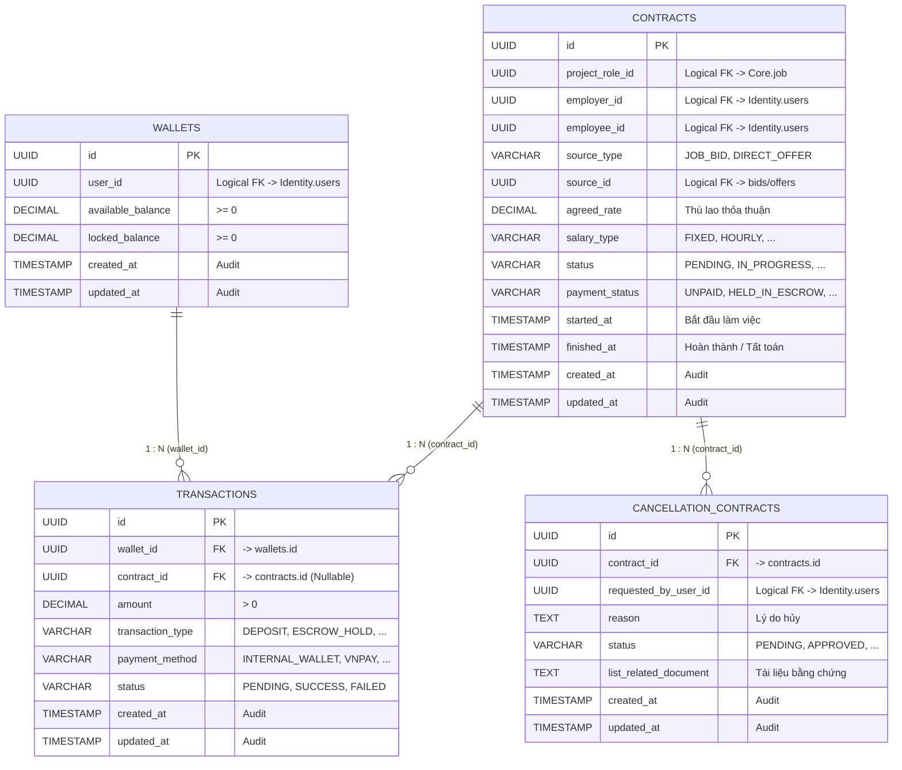

# Đặc tả Cơ sở Dữ liệu Dịch vụ Thanh toán (Payment Service ERD)

> **Bounded Context**: **Payment** (`occupify-payment`)  
> **Database Name**: `occupify_payment` (PostgreSQL 16 Alpine)  
> **Tài liệu tham chiếu toàn hệ thống**: Xem **[ECOSYSTEM-ERD.md](ECOSYSTEM-ERD.md)** để nắm toàn cảnh cấu trúc 5 Bounded Contexts của Occupify.

---

## 1. Giới thiệu Bounded Context Payment

Dịch vụ **Payment** (`occupify-payment`) là trung tâm tài chính và pháp lý trong hệ sinh thái Occupify, quản lý 4 bảng nghiệp vụ cốt lõi:
1. **`contracts`**: Hợp đồng dịch vụ lao động/dự án giữa Employer và Employee.
2. **`cancellation_contracts`**: Quy trình khiếu nại, giải quyết tranh chấp và hủy hợp đồng.
3. **`wallets`**: Ví điện tử tài khoản cá nhân, duy trì 2 ngăn tiền (`available_balance` và `locked_balance`).
4. **`transactions`**: Sổ cái bất biến (Append-only Ledger) ghi nhận toàn bộ các giao dịch tài chính (Nạp, Rút, Ký quỹ Escrow, Giải ngân Payout, Hoàn tiền Refund, Phí dịch vụ sàn).

---

## 2. Sơ đồ Quan hệ Thực thể Nội bộ (Internal ERD)

Trong phạm vi CSDL `occupify_payment`, sơ đồ quan hệ vật lý (Physical Foreign Keys) và các trường kiểm toán (Audit Fields: `created_at`, `updated_at`) được mô hình hóa như sau:

---

## 3. Đặc tả Chi tiết Các Bảng Dữ liệu

### 3.1. Bảng `contracts` (Hợp đồng dịch vụ)

Bảng trung tâm lưu trữ thông tin pháp lý và tài chính của thỏa thuận giữa Employer và Employee.

| Tên cột | Kiểu dữ liệu | Ràng buộc | Giá trị mặc định | Mô tả nghiệp vụ |
|:---|:---|:---|:---|:---|
| `id` | `UUID` | **PK**, NOT NULL | `gen_random_uuid()` | Khóa chính duy nhất của hợp đồng |
| `project_role_id` | `UUID` | NOT NULL | None | Logical FK trỏ tới Job/Role trong Bounded Context **Core** (`job.id`) |
| `employer_id` | `UUID` | NOT NULL | None | Logical FK trỏ tới Nhà tuyển dụng (`Identity.users.id`) |
| `employee_id` | `UUID` | NULLABLE | NULL | Logical FK trỏ tới Freelancer/Nhân sự (`Identity.users.id`). Có thể null khi khởi tạo ban đầu |
| `source_type` | `VARCHAR(50)` | NOT NULL | None | Nguồn gốc hợp đồng: `JOB_BID`, `DIRECT_OFFER`, `PROJECT_CONTRACT` |
| `source_id` | `UUID` | NOT NULL | None | Logical FK trỏ tới bản ghi nguồn (VD: `Core.bids.id` hoặc `Core.offers.id`) |
| `agreed_rate` | `DECIMAL(19, 4)` | NOT NULL | None | Mức thù lao thống nhất chi trả (Giá trị tiền tệ) |
| `salary_type` | `VARCHAR(50)` | NOT NULL | None | Chu kỳ/hình thức thù lao: `FIXED`, `HOURLY`, `DAILY`, `WEEKLY`, `MONTHLY` |
| `status` | `VARCHAR(50)` | NOT NULL | `'PENDING'` | Trạng thái hợp đồng: `PENDING`, `IN_PROGRESS`, `COMPLETED`, `CANCELLED`, `DISPUTED` |
| `payment_status` | `VARCHAR(50)` | NOT NULL | `'UNPAID'` | Trạng thái thanh toán: `UNPAID`, `HELD_IN_ESCROW`, `PARTIALLY_PAID`, `PAID`, `REFUNDED` |
| `started_at` | `TIMESTAMP WITH TIME ZONE` | NULLABLE | NULL | Thời điểm chính thức bắt đầu công việc |
| `finished_at` | `TIMESTAMP WITH TIME ZONE` | NULLABLE | NULL | Thời điểm hoàn thành hoặc đóng hợp đồng |
| `created_at` | `TIMESTAMP WITH TIME ZONE` | NOT NULL | `CURRENT_TIMESTAMP` | Thời điểm tạo bản ghi (Audit) |
| `updated_at` | `TIMESTAMP WITH TIME ZONE` | NOT NULL | `CURRENT_TIMESTAMP` | Thời điểm cập nhật cuối cùng (Audit) |

---

### 3.2. Bảng `cancellation_contracts` (Yêu cầu hủy hợp đồng)

Quản lý tiến trình xử lý khiếu nại, chấm dứt hợp đồng trước hạn hoặc tranh chấp thanh toán.

| Tên cột | Kiểu dữ liệu | Ràng buộc | Giá trị mặc định | Mô tả nghiệp vụ |
|:---|:---|:---|:---|:---|
| `id` | `UUID` | **PK**, NOT NULL | `gen_random_uuid()` | Khóa chính của yêu cầu hủy hợp đồng |
| `contract_id` | `UUID` | **FK** -> `contracts.id`, NOT NULL | None | Tham chiếu vật lý đến hợp đồng bị yêu cầu hủy |
| `requested_by_user_id` | `UUID` | NOT NULL | None | Logical FK trỏ đến User khởi tạo yêu cầu hủy (`Identity.users.id`) |
| `reason` | `TEXT` | NOT NULL | None | Lý do chấm dứt/hủy bỏ hợp đồng |
| `status` | `VARCHAR(50)` | NOT NULL | `'PENDING'` | Trạng thái yêu cầu: `PENDING`, `APPROVED`, `REJECTED`, `DISPUTED` |
| `list_related_document` | `TEXT` / `JSONB` | NULLABLE | NULL | Danh sách link tài liệu, bằng chứng, biên bản đính kèm |
| `created_at` | `TIMESTAMP WITH TIME ZONE` | NOT NULL | `CURRENT_TIMESTAMP` | Thời điểm gửi yêu cầu hủy (Audit) |
| `updated_at` | `TIMESTAMP WITH TIME ZONE` | NOT NULL | `CURRENT_TIMESTAMP` | Thời điểm cập nhật trạng thái yêu cầu hủy (Audit) |

---

### 3.3. Bảng `wallets` (Ví điện tử tài khoản)

Quản lý tài khoản tiền tệ của người dùng trong hệ thống Occupify. Mỗi người dùng chỉ có 1 ví duy nhất.

| Tên cột | Kiểu dữ liệu | Ràng buộc | Giá trị mặc định | Mô tả nghiệp vụ |
|:---|:---|:---|:---|:---|
| `id` | `UUID` | **PK**, NOT NULL | `gen_random_uuid()` | Khóa chính của ví tiền |
| `user_id` | `UUID` | **UQ**, NOT NULL | None | Logical FK trỏ tới chủ sở hữu ví (`Identity.users.id`). Đảm bảo quan hệ 1-1 |
| `available_balance` | `DECIMAL(19, 4)` | NOT NULL, `>= 0` | `0.0000` | Số dư khả dụng (có thể dùng để thanh toán mới hoặc rút tiền) |
| `locked_balance` | `DECIMAL(19, 4)` | NOT NULL, `>= 0` | `0.0000` | Số dư bị phong tỏa / ký quỹ (Escrow) đảm bảo thanh toán hợp đồng |
| `created_at` | `TIMESTAMP WITH TIME ZONE` | NOT NULL | `CURRENT_TIMESTAMP` | Thời điểm tạo ví (Audit) |
| `updated_at` | `TIMESTAMP WITH TIME ZONE` | NOT NULL | `CURRENT_TIMESTAMP` | Thời điểm cập nhật số dư (Audit) |

---

### 3.4. Bảng `transactions` (Lịch sử giao dịch sổ cái)

Bảng ghi chép tất cả các giao dịch tài chính (bất biến - Append Only).

| Tên cột | Kiểu dữ liệu | Ràng buộc | Giá trị mặc định | Mô tả nghiệp vụ |
|:---|:---|:---|:---|:---|
| `id` | `UUID` | **PK**, NOT NULL | `gen_random_uuid()` | Khóa chính của giao dịch |
| `wallet_id` | `UUID` | **FK** -> `wallets.id`, NOT NULL | None | Tham chiếu vật lý đến ví thực hiện giao dịch |
| `contract_id` | `UUID` | **FK** -> `contracts.id`, NULLABLE | NULL | Hợp đồng liên quan (nếu giao dịch gắn liền với hợp đồng) |
| `amount` | `DECIMAL(19, 4)` | NOT NULL, `> 0` | None | Số tiền giao dịch (luôn là số dương) |
| `transaction_type` | `VARCHAR(50)` | NOT NULL | None | Loại giao dịch: `DEPOSIT`, `WITHDRAWAL`, `ESCROW_HOLD`, `ESCROW_RELEASE`, `ESCROW_REFUND`, `PLATFORM_FEE` |
| `payment_method` | `VARCHAR(50)` | NOT NULL | None | Phương thức thanh toán: `INTERNAL_WALLET`, `VNPAY`, `STRIPE`, `BANK_TRANSFER`, `MOMO` |
| `status` | `VARCHAR(50)` | NOT NULL | `'PENDING'` | Trạng thái giao dịch: `PENDING`, `SUCCESS`, `FAILED`, `CANCELLED` |
| `created_at` | `TIMESTAMP WITH TIME ZONE` | NOT NULL | `CURRENT_TIMESTAMP` | Thời điểm phát sinh giao dịch (Audit) |
| `updated_at` | `TIMESTAMP WITH TIME ZONE` | NOT NULL | `CURRENT_TIMESTAMP` | Thời điểm cập nhật trạng thái giao dịch (Audit) |

---

## 4. Ràng buộc Toàn vẹn & Invariants Nghiệp vụ Tài chính

1. **Balance Non-Negativity Invariant**:
   - `available_balance >= 0` VÀ `locked_balance >= 0`. Cơ sở dữ liệu bắt buộc có Check Constraint kiểm tra điều kiện này.
2. **Escrow Life Cycle (Vòng đời ký quỹ)**:
   - Khi ký hợp đồng và bắt đầu công việc:
     $$\text{Employer.available\_balance} \xrightarrow{-\text{amount}} \text{Employer.locked\_balance} \quad (\text{type: ESCROW\_HOLD})$$
   - Khi nghiệm thu hoàn tất (`Finish Contract`):
     $$\text{Employer.locked\_balance} \xrightarrow{-\text{amount}} \text{Employee.available\_balance} \quad (\text{type: ESCROW\_RELEASE})$$
   - Khi hủy hợp đồng có hoàn tiền (`Cancellation Approved`):
     $$\text{Employer.locked\_balance} \xrightarrow{-\text{amount}} \text{Employer.available\_balance} \quad (\text{type: ESCROW\_REFUND})$$
3. **Audit Log & Ledger Immutability (Bất biến sổ cái)**:
   - Dữ liệu trong bảng `transactions` là bất biến (không bao giờ UPDATE `amount` hoặc DELETE bản ghi thành công). Mọi điều chỉnh đều phải tạo transaction mới bù trừ.
4. **Mô Hình Một Tài Khoản - Hai Vai Trò (Dual-Role Model: EMPLOYEE và EMPLOYER là một người)**:
   - **Một người dùng, một giao diện hai không gian**: Người dùng sử dụng chung một tài khoản đăng nhập và cùng một giao diện để chuyển đổi giữa Freelancer Workspace (vai trò `EMPLOYEE`) và Client Workspace (vai trò `EMPLOYER`).
   - **Ví điện tử duy nhất**: Mỗi user chỉ có đúng 1 ví (`wallets.user_id = users.id`). Ví này vừa nhận tiền giải ngân khi đi làm thuê, vừa dùng để ký quỹ khi đi thuê người khác.
   - **Ràng buộc cấm tự ký hợp đồng với chính mình**: Trong bảng `contracts`, bắt buộc:
     $$\text{contracts.employer\_id} \neq \text{contracts.employee\_id}$$
     Flyway migration cần có check constraint: `CONSTRAINT chk_contracts_different_parties CHECK (employer_id <> employee_id)`. Một user có thể là Employer ở hợp đồng này và Employee ở hợp đồng khác.
---

## 5. Ma trận Khóa Ngoại Logic của Payment với các Bounded Context Khác

| Cột trong `occupify_payment` | Bảng nội bộ | Bounded Context Đích | Bảng Đích | Ý nghĩa nghiệp vụ |
|:---|:---|:---|:---|:---|
| `employer_id` | `contracts` | **Identity** | `users.id` | Khách hàng chi trả thù lao |
| `employee_id` | `contracts` | **Identity** | `users.id` | Freelancer thực hiện công việc |
| `project_role_id` | `contracts` | **Core** | `job.id` | Vị trí công việc tuyển dụng |
| `source_id` | `contracts` | **Core** | `bids.id` / `offers.id` | Báo giá chào thầu hoặc Lời mời trực tiếp |
| `requested_by_user_id` | `cancellation_contracts`| **Identity** | `users.id` | Người gửi yêu cầu hủy hợp đồng |
| `user_id` | `wallets` | **Identity** | `users.id` | Chủ sở hữu ví tiền |
| *Được tham chiếu bởi* | *Bảng bên ngoài* | *Bounded Context nguồn* | *Cột tham chiếu* | *Ý nghĩa nghiệp vụ* |
| `contracts.id` | `reviews` | **Core** | `contract_id` | Đánh giá được mở sau khi hợp đồng hoàn thành |
| `contracts.id` | `offers` | **Core** | `contract_id` | Offer liên kết tới hợp đồng được tạo |

---

## 6. Danh Mục Enums Nghiệp Vụ của Payment

### 6.1. `ContractStatus` (`contracts.status`)
- `PENDING`: Mới được khởi tạo từ bid/offer, đang chờ hai bên xác nhận điều khoản và nạp cọc.
- `IN_PROGRESS`: Tiền đã được giữ trong ví ký quỹ (Escrow), freelancer đang thực hiện công việc.
- `COMPLETED`: Công việc đã hoàn tất, tiền đã được giải ngân cho freelancer.
- `CANCELLED`: Hợp đồng bị hủy bởi sự đồng thuận hoặc khiếu nại được xử lý.
- `DISPUTED`: Đang xảy ra tranh chấp giữa hai bên cần can thiệp của Quản trị viên (Admin).

### 6.2. `PaymentStatus` (`contracts.payment_status`)
- `UNPAID`: Chưa có khoản tiền nào được thanh toán hoặc đặt cọc.
- `HELD_IN_ESCROW`: Số tiền thù lao đã được phong tỏa trong `locked_balance` của Employer.
- `PARTIALLY_PAID`: Đã thanh toán một phần (áp dụng cho hợp đồng theo milestone/giờ).
- `PAID`: Đã giải ngân toàn bộ số tiền thù lao cho Employee.
- `REFUNDED`: Tiền ký quỹ đã được hoàn trả lại cho Employer.

### 6.3. `SalaryType` (`contracts.salary_type`)
- `FIXED`: Thù lao trọn gói theo dự án / sản phẩm.
- `HOURLY`: Thù lao tính theo giờ làm việc thực tế.
- `DAILY`: Thù lao tính theo ngày làm việc.
- `WEEKLY`: Thù lao tính theo tuần.
- `MONTHLY`: Thù lao tính theo tháng (dành cho hợp đồng dài hạn).

### 6.4. `TransactionType` (`transactions.transaction_type`)
- `DEPOSIT`: Nạp tiền vào ví khả dụng từ cổng thanh toán bên ngoài.
- `WITHDRAWAL`: Yêu cầu rút tiền từ ví khả dụng về tài khoản ngân hàng.
- `ESCROW_HOLD`: Chuyển tiền từ `available_balance` sang `locked_balance` để ký quỹ hợp đồng.
- `ESCROW_RELEASE`: Chuyển tiền từ `locked_balance` của Employer sang `available_balance` của Employee.
- `ESCROW_REFUND`: Chuyển trả tiền từ `locked_balance` về `available_balance` của Employer khi hủy hợp đồng.
- `PLATFORM_FEE`: Khấu trừ phí dịch vụ sàn kết nối.

### 6.5. `PaymentMethod` (`transactions.payment_method`)
- `INTERNAL_WALLET`: Sử dụng số dư ví Occupify.
- `VNPAY`: Cổng thanh toán trực tuyến VNPAY (ATM / QR / Thẻ nội địa).
- `STRIPE`: Thẻ quốc tế Visa/Mastercard qua Stripe.
- `BANK_TRANSFER`: Chuyển khoản ngân hàng trực tiếp qua QR Napas.
- `MOMO`: Ví điện tử MoMo.

### 6.6. `CancellationStatus` (`cancellation_contracts.status`)
- `PENDING`: Đang chờ đối tác phản hồi hoặc xem xét.
- `APPROVED`: Yêu cầu hủy đã được chấp thuận (kích hoạt hoàn tiền hoặc tất toán phần đã làm).
- `REJECTED`: Yêu cầu hủy bị từ chối.
- `DISPUTED`: Hai bên không thống nhất, chuyển vụ việc sang Quản trị viên giải quyết.

---

## 7. Khuyến nghị Kỹ thuật & Cấu hình Database Migration

1. **Khóa Bi Quan (Pessimistic Write Locking)**:
   - Khi thực hiện `ESCROW_HOLD`, `ESCROW_RELEASE` hoặc `ESCROW_REFUND`, bắt buộc truy vấn ví thông qua `@Lock(LockModeType.PESSIMISTIC_WRITE)` trên `WalletRepository` để đảm bảo tính tuần tự tuyệt đối, tránh race condition số dư.
2. **PostgreSQL Check Constraints**:
   - Thêm constraint trong Flyway: `CONSTRAINT chk_wallet_available_positive CHECK (available_balance >= 0)` và `CONSTRAINT chk_wallet_locked_positive CHECK (locked_balance >= 0)`.
3. **Quản lý Migration với Flyway**:
   - Toàn bộ schema trên được định nghĩa tuần tự trong `src/main/resources/db/migration/V1__init_payment_schema.sql`.
