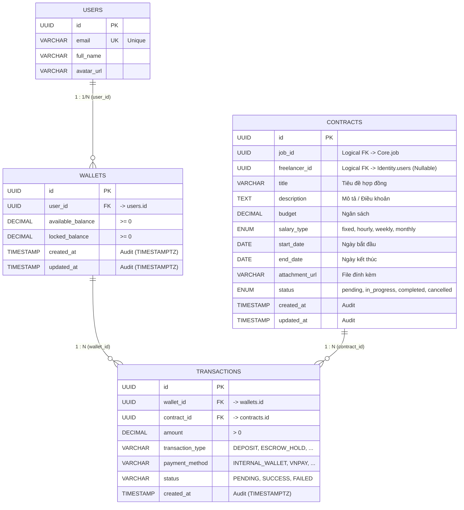

# Đặc tả Cơ sở Dữ liệu Dịch vụ Thanh toán (Payment Service ERD)

> **Bounded Context**: **Payment** (`occupify-payment`)  
> **Database Name**: `occupify_payment` (PostgreSQL 16 Alpine)  
> **Tài liệu tham chiếu toàn hệ thống**: Xem **[ECOSYSTEM-ERD.md](ECOSYSTEM-ERD.md)** để nắm toàn cảnh cấu trúc 5 Bounded Contexts của Occupify.

---

## 1. Giới thiệu Bounded Context Payment

Dịch vụ **Payment** (`occupify-payment`) là trung tâm tài chính và pháp lý trong hệ sinh thái Occupify, quản lý 4 bảng dữ liệu cốt lõi:
1. **`wallets`**: Ví tiền cá nhân của người dùng, quản lý số dư khả dụng (`available_balance`) và số dư bị phong tỏa / ký quỹ (`locked_balance`).
2. **`transactions`**: Sổ cái bất biến (Append-only Ledger) ghi nhận toàn bộ các giao dịch tài chính (Nạp, Rút, Ký quỹ Escrow, Giải ngân Payout, Hoàn tiền Refund, Phí dịch vụ sàn).
3. **`users`**: Thực thể người dùng nội bộ (Local Replicated Entity sao chép từ Identity) giúp ràng buộc khóa ngoại vật lý và truy vấn số dư trực tiếp.
4. **`contracts`**: Hợp đồng dịch vụ việc làm/dự án (Local Replicated Entity sao chép từ Core), lưu trữ thông tin điều khoản, ngân sách và trạng thái hợp đồng để phục vụ giao dịch và giải ngân.

---

## 2. Sơ đồ Quan hệ Thực thể Nội bộ (Internal ERD)

Trong phạm vi CSDL `occupify_payment`, sơ đồ quan hệ thực thể vật lý (Physical Foreign Keys) và các trường kiểm toán (Audit Fields: `created_at`, `updated_at`) được mô hình hóa như sau:

---

## 3. Đặc tả Chi tiết Các Bảng Dữ liệu

### 3.1. Bảng `wallets` (Ví tiền)

Quản lý tài khoản tiền tệ của người dùng trong hệ thống Occupify. Một người dùng có thể sở hữu một hoặc nhiều ví.

| Tên cột | Kiểu dữ liệu | Ràng buộc | Giá trị mặc định | Mô tả nghiệp vụ |
|:---|:---|:---|:---|:---|
| `id` | `UUID` | **PK**, NOT NULL | `gen_random_uuid()` | Khóa chính định danh ví tiền |
| `user_id` | `UUID` | **FK** -> `users.id`, NOT NULL | None | Tham chiếu vật lý đến chủ sở hữu ví (`users.id` nội bộ) |
| `available_balance` | `DECIMAL` | NOT NULL, `>= 0` | `0.0000` | Số dư khả dụng (dùng thanh toán, ký quỹ hoặc rút tiền) |
| `locked_balance` | `DECIMAL` | NOT NULL, `>= 0` | `0.0000` | Số dư bị phong tỏa / ký quỹ (Escrow) đảm bảo hợp đồng |
| `created_at` | `TIMESTAMP WITH TIME ZONE` | NOT NULL | `CURRENT_TIMESTAMP` | Thời điểm tạo ví (Audit) |
| `updated_at` | `TIMESTAMP WITH TIME ZONE` | NOT NULL | `CURRENT_TIMESTAMP` | Thời điểm cập nhật số dư (Audit) |

---

### 3.2. Bảng `transactions` (Giao dịch)

Bảng ghi chép tất cả các giao dịch tài chính (bất biến - Append Only).

| Tên cột | Kiểu dữ liệu | Ràng buộc | Giá trị mặc định | Mô tả nghiệp vụ |
|:---|:---|:---|:---|:---|
| `id` | `UUID` | **PK**, NOT NULL | `gen_random_uuid()` | Khóa chính của giao dịch |
| `wallet_id` | `UUID` | **FK** -> `wallets.id`, NOT NULL | None | Tham chiếu vật lý đến ví thực hiện giao dịch |
| `contract_id` | `UUID` | **FK** -> `contracts.id`, NOT NULL | None | Hợp đồng liên quan đến giao dịch |
| `amount` | `DECIMAL` | NOT NULL, `> 0` | None | Số tiền giao dịch (luôn là số dương) |
| `transaction_type` | `VARCHAR(50)` | NOT NULL | None | Loại giao dịch: `DEPOSIT`, `WITHDRAWAL`, `ESCROW_HOLD`, `ESCROW_RELEASE`, `ESCROW_REFUND`, `PLATFORM_FEE` |
| `payment_method` | `VARCHAR(50)` | NOT NULL | None | Phương thức thanh toán: `INTERNAL_WALLET`, `VNPAY`, `STRIPE`, `BANK_TRANSFER`, `MOMO` |
| `status` | `VARCHAR(50)` | NOT NULL | `'PENDING'` | Trạng thái giao dịch: `PENDING`, `SUCCESS`, `FAILED`, `CANCELLED` |
| `created_at` | `TIMESTAMP WITH TIME ZONE` | NOT NULL | `CURRENT_TIMESTAMP` | Thời điểm phát sinh giao dịch (Audit) |

---

### 3.3. Bảng `users` (Người dùng - Local Entity)

Bảng thực thể sao chép từ Bounded Context **Identity**, phục vụ duy trì ràng buộc khóa ngoại nội bộ với `wallets`.

| Tên cột | Kiểu dữ liệu | Ràng buộc | Giá trị mặc định | Mô tả nghiệp vụ |
|:---|:---|:---|:---|:---|
| `id` | `UUID` | **PK**, NOT NULL | None | Khóa chính định danh người dùng (đồng bộ từ Identity) |
| `email` | `VARCHAR(255)` | **UQ**, NOT NULL | None | Email người dùng |
| `full_name` | `VARCHAR(150)` | NOT NULL | None | Họ và tên người dùng |
| `avatar_url` | `VARCHAR(500)` | NULLABLE | NULL | Đường dẫn ảnh đại diện |

---

### 3.4. Bảng `contracts` (Hợp đồng - Local Entity sao chép từ Core)

Bảng lưu trữ thông tin hợp đồng thỏa thuận công việc sao chép từ service **Core**, phục vụ xử lý giao dịch, ký quỹ và giải ngân.

| Tên cột | Kiểu dữ liệu | Ràng buộc | Giá trị mặc định | Mô tả nghiệp vụ |
|:---|:---|:---|:---|:---|
| `id` | `UUID` | **PK**, NOT NULL | `gen_random_uuid()` | Khóa chính định danh duy nhất của hợp đồng |
| `job_id` | `UUID` | **FK (Logical)**, NOT NULL | None | Khóa ngoại logic trỏ tới vị trí công việc (`Core.job.id`) |
| `freelancer_id` | `UUID` | **FK (Logical)**, NULLABLE | NULL | Khóa ngoại logic trỏ tới Freelancer (`Identity.users.id`) |
| `title` | `VARCHAR(255)` | NOT NULL | None | Tiêu đề hợp đồng công việc |
| `description` | `TEXT` | NULLABLE | NULL | Nội dung chi tiết / điều khoản hợp đồng |
| `budget` | `DECIMAL` | NOT NULL, `> 0` | None | Ngân sách / giá trị hợp đồng |
| `salary_type` | `ENUM('fixed', 'hourly', 'weekly', 'monthly')` | NOT NULL | None | Hình thức thanh toán thù lao |
| `start_date` | `DATE` | NULLABLE | NULL | Ngày bắt đầu thực hiện |
| `end_date` | `DATE` | NULLABLE | NULL | Ngày kết thúc thực hiện |
| `attachment_url` | `VARCHAR(500)` | NULLABLE | NULL | Đường dẫn file đính kèm |
| `status` | `ENUM('pending', 'in_progress', 'completed', 'cancelled')` | NOT NULL | `'pending'` | Trạng thái thực hiện hợp đồng |
| `created_at` | `TIMESTAMP` | NOT NULL | `CURRENT_TIMESTAMP` | Thời điểm tạo hợp đồng (Audit) |
| `updated_at` | `TIMESTAMP` | NOT NULL | `CURRENT_TIMESTAMP` | Thời điểm cập nhật cuối cùng (Audit) |

---

## 4. Các Mối Quan Hệ (Relationships)

### 4.1. Quan hệ Nội bộ Service Payment (Internal Physical Relationships)
1. **`users (1) - (1/N) wallets`**: Một người dùng (User) sở hữu một hoặc nhiều ví (Wallets). Liên kết thông qua trường `user_id` trong bảng `wallets` tham chiếu đến `id` của bảng `users`.
2. **`wallets (1) - (N) transactions`**: Một ví (Wallet) có thể có nhiều giao dịch (Transactions). Liên kết thông qua trường `wallet_id` trong bảng `transactions` tham chiếu đến `id` của bảng `wallets`.
3. **`contracts (1) - (N) transactions`**: Một hợp đồng (Contract) có thể có liên quan đến nhiều giao dịch thanh toán. Liên kết thông qua trường `contract_id` trong bảng `transactions` tham chiếu đến `id` của bảng `contracts`.

### 4.2. Tham Chiếu Khóa Ngoại Liên Dịch Vụ (Cross-Service Logical References)
Bảng `contracts` chứa các khóa ngoại logic có đích đến nằm trong service khác:
- **`contracts.job_id`**: Khóa ngoại logic liên kết với bảng `job` trong service **Core**.
- **`contracts.freelancer_id`**: Khóa ngoại logic liên kết với bảng `users` trong service **Identity** (dưới vai trò freelancer, có thể NULL khi khởi tạo ban đầu).

### 4.3. Đồng Bộ Dữ Liệu Thực Thể Sao Chép (Entity Synchronization)
- Bảng `users` trong service Payment được đồng bộ từ service **Identity** thông qua Domain Events (`UserCreatedEvent`, `UserUpdatedEvent`) trên message broker (Kafka).
- Bảng `contracts` trong service Payment được đồng bộ từ service **Core** thông qua Domain Events (`ContractCreatedEvent`, `ContractStatusUpdatedEvent`) trên message broker (Kafka).

---

## 5. Ràng buộc Toàn vẹn & Invariants Nghiệp vụ Tài chính

1. **Balance Non-Negativity Invariant**:
   - `available_balance >= 0` VÀ `locked_balance >= 0`. Cơ sở dữ liệu bắt buộc có Check Constraint kiểm tra điều kiện này.
2. **Escrow Life Cycle (Vòng đời ký quỹ)**:
   - Khi ký hợp đồng và bắt đầu công việc: Tiền từ `available_balance` của ví Client chuyển sang `locked_balance` (`ESCROW_HOLD`).
   - Khi hoàn tất nghiệm thu hợp đồng (`completed`): Tiền từ `locked_balance` của ví Client chuyển sang `available_balance` của ví Freelancer (`ESCROW_RELEASE`).
   - Khi hủy hợp đồng (`cancelled`): Tiền từ `locked_balance` được hoàn trả về `available_balance` của ví Client (`ESCROW_REFUND`).
3. **Ledger Immutability (Bất biến sổ cái)**:
   - Dữ liệu trong bảng `transactions` là bất biến (không bao giờ UPDATE `amount` hoặc DELETE bản ghi). Mọi điều chỉnh đều phải tạo transaction mới bù trừ.

---

## 6. Danh Mục Enums Nghiệp Vụ của Payment

### 6.1. `salary_type` (`contracts.salary_type`)
- `fixed`: Thù lao trọn gói theo dự án / sản phẩm.
- `hourly`: Thù lao tính theo giờ làm việc thực tế.
- `weekly`: Thù lao tính theo tuần.
- `monthly`: Thù lao tính theo tháng (dành cho hợp đồng dài hạn).

### 6.2. `status` (`contracts.status`)
- `pending`: Mới được khởi tạo, đang chờ hai bên xác nhận và đặt cọc/ký quỹ.
- `in_progress`: Tiền đã được giữ trong ví ký quỹ (Escrow), freelancer đang thực hiện công việc.
- `completed`: Công việc đã hoàn tất, tiền đã được giải ngân cho freelancer.
- `cancelled`: Hợp đồng bị hủy bỏ.

### 6.3. `transaction_type` (`transactions.transaction_type`)
- `DEPOSIT`: Nạp tiền vào ví khả dụng từ cổng thanh toán bên ngoài.
- `WITHDRAWAL`: Yêu cầu rút tiền từ ví khả dụng về tài khoản ngân hàng.
- `ESCROW_HOLD`: Chuyển tiền từ `available_balance` sang `locked_balance` để ký quỹ hợp đồng.
- `ESCROW_RELEASE`: Chuyển tiền từ `locked_balance` của Client sang `available_balance` của Freelancer.
- `ESCROW_REFUND`: Chuyển trả tiền từ `locked_balance` về `available_balance` của Client khi hủy hợp đồng.
- `PLATFORM_FEE`: Khấu trừ phí dịch vụ sàn kết nối.

### 6.4. `payment_method` (`transactions.payment_method`)
- `INTERNAL_WALLET`: Sử dụng số dư ví Occupify.
- `VNPAY`: Cổng thanh toán trực tuyến VNPAY.
- `STRIPE`: Thẻ quốc tế Visa/Mastercard qua Stripe.
- `BANK_TRANSFER`: Chuyển khoản ngân hàng trực tiếp qua QR Napas.
- `MOMO`: Ví điện tử MoMo.

### 6.5. `status` (`transactions.status`)
- `PENDING`: Đang chờ cổng thanh toán hoặc hệ thống xử lý.
- `SUCCESS`: Giao dịch thành công.
- `FAILED`: Giao dịch thất bại.
- `CANCELLED`: Giao dịch đã bị hủy.
